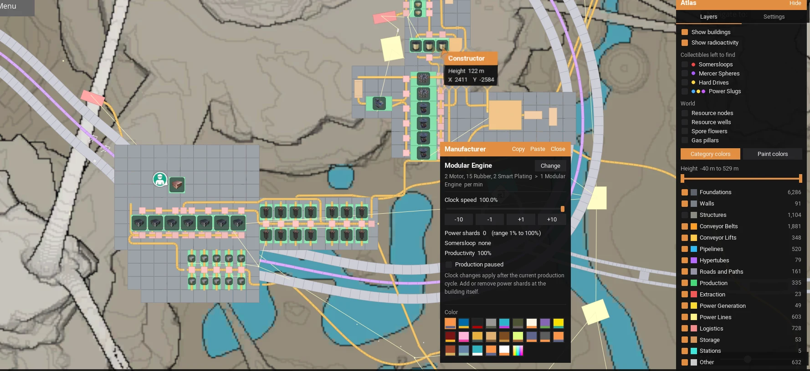

# Atlas

A [Satisfactory](https://www.satisfactorygame.com/) mod that turns the in-game map into a proper factory map.
Every building you own is drawn live on it, at almost no cost to the game.

For Satisfactory 1.2 with [SML](https://ficsit.app/mod/SML) 3.12. Mod reference: `FactoryAtlas`.

## Features

**The map**
- Every building drawn to scale, modded ones included, updating as you build
- Layers by category or building type, and a height slider to show one floor
- Category colors, your own colors, or the buildings' real paint
- Collectibles, resource nodes, wells, spore flowers, gas pillars and radioactivity, or a spoiler-free map without them
- Status lights (optional): green producing, purple overclocked, yellow standby, red error
- Up to 8x zoom, fullscreen, a second window for another monitor, and PNG export

**Working from the map**
- Hover a building for its name, height and coordinates
- Click a machine to set its clock speed, recipe or pause
- Ctrl + right click copies a building's settings, Ctrl + left click (or drag) pastes them
- Build belts, pipes, hypertubes and railway by dragging between ports
- Run power lines with Alt + W: click one building, then the next, or the ground for a pole
- Measure with G: box sizes in metres and foundations, and copies that turn red where they would hit something

Building from the map goes through the game's own holograms and takes the real cost, from your
inventory and then the Dimensional Depot. Settings are on the right of the map screen and under Mods > Atlas.

## Performance

Atlas draws nothing until the map is open. Each building is a 16-byte record drawn by the GPU in a
few instanced draw calls, with no render target, so panning, zooming and filtering redraw nothing.
A million extra buildings cost about 0.3 ms of CPU per frame in testing.

## Limitations

- Building from the map, and configuring machines, work in single player and for the host only.
- Multiplayer clients only see the buildings the game has sent them.
- Spore flowers and gas pillars appear once their part of the world has been loaded.

## Building

1. Junction the repo into an SML 3.12 project as `Mods/GameFeatures/FactoryAtlas` and build `FactoryEditor`.
2. Generate the assets with `UnrealEditor-Cmd.exe <SML>\FactoryGame.uproject -run=pythonscript -script=<repo>\Scripts\<script> -unattended -nosplash`,
   running `create_assets.py` then `import_sounds.py` (its exit code 1 is a harmless BINKA decoder check).
3. Package with Alpakit.

## Credits

Inspired by [Cartograph](https://ficsit.app/mod/Cartograph) by yeshjho, but written from scratch. The map
bounds are the ones Cartograph worked out with help from [SCIM](https://satisfactory-calculator.com/).
